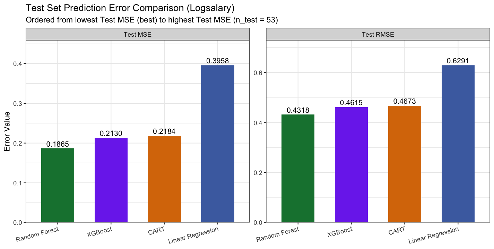
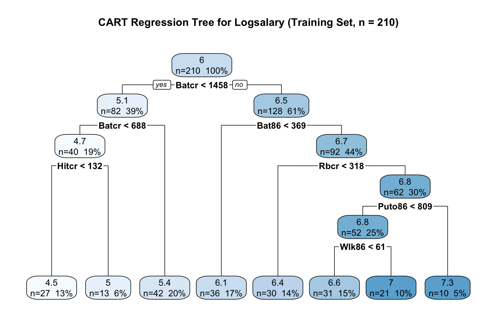
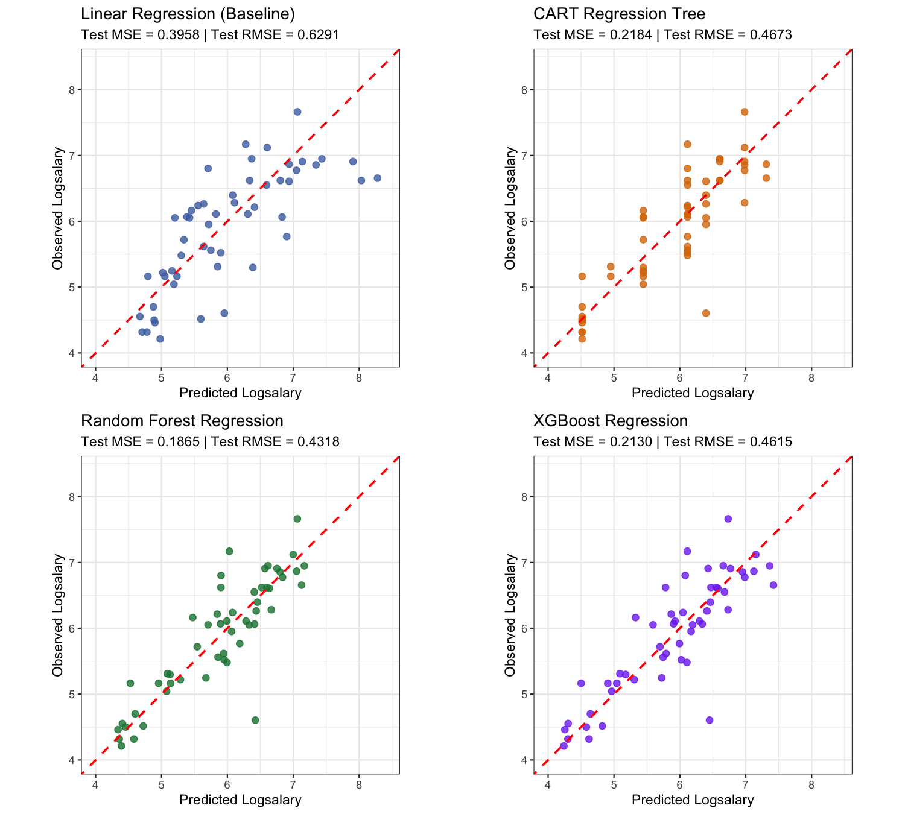

# 棒球球員薪資預測研究報告：CART、Random Forest 與 XGBoost 比較分析

> **資料公開說明**：本研究使用課程教師提供之棒球球員薪資資料集（`ball.txt`）。基於公開範圍與教材授權考量，公開版 Repository 未納入原始資料檔、教師範例腳本及逐筆球員預測明細；本報告所列實驗數據與視覺化圖表均為以完整資料集實際執行分析之真實結果。

## 一、研究背景與目標

本研究使用棒球球員薪資資料集 `ball.txt`（共 263 筆球員觀測值、26 個欄位），以 1987 年球員對數薪資 `Logsalary`（$\ln(\text{Salary})$）作為唯一預測目標，比較以下三種樹狀與集成學習迴歸模型的測試集預測誤差，並保留 **Multiple Linear Regression（多元線性迴歸）** 作為傳統統計基準模型：

1. **Multiple Linear Regression (`glm`)**：傳統統計基準線
2. **CART Regression Tree (`rpart`)**：單一迴歸決策樹
3. **Random Forest Regression (`randomForest`)**：Bagging 隨機森林集成模型
4. **XGBoost Regression (`xgboost`)**：Gradient Boosting 梯度提升集成模型

評估指標以共同測試集（`n = 53`）上的 **MSE（Mean Squared Error）** 為主要比較基準，並以 **RMSE（Root Mean Squared Error）** 作為輔助指標。

---

## 二、資料處理、洩漏防範與特徵選擇

### 2.1 強制排除欄位與資料洩漏檢查

建立分析模型前，嚴格從建模資料中移除以下三個欄位，不修改原始 `ball.txt`：

- `Id`、`Name`：球員識別碼與姓名，僅為資料識別用途，不具統計預測意義。
- `Salary`：1987 年原始薪資（單位：千美元）。經實測 $\max |\ln(\text{Salary}) - \text{Logsalary}| = 5.33 \times 10^{-15}$，兩者存在完全數學對應關係，若納入特徵將導致 100% 目標洩漏（Target Leakage）。

同時，本研究修正了原始範例程式 `CART_Baseball.r` 中的關鍵錯誤：

1. **修正訓練集／測試集洩漏**：原始範例誤將全資料集 `data = Baseball` 傳入 `rpart()` 建模後再對 `test_data` 評估；正式流程嚴格限定所有模型僅使用 80% 訓練集（`train_data`，210 筆）建模，20% 測試集（`test_data`，53 筆）僅用於最後誤差評估。
2. **修正資料切分邏輯**：設定固定隨機種子 `set.seed(123)`，並比照 `RF_Test.r` 與 `XGBoost_Test.r` 使用目標向量呼叫 `caTools::sample.split(model_df$Logsalary, SplitRatio = 0.8)`，避免對整個 `data.frame` 切分造成欄位數向量循環（Vector Recycling）錯誤。
3. **修正評估繪圖與監控設定**：將 `qqplot()`（各自獨立排序而破壞樣本配對）改為真實配對的 Predicted vs. Observed 散佈圖；且不在 `xgb.train()` 傳入測試集至 `watchlist`。

### 2.2 採用 19 個共同預測特徵之說明

扣除 `Id`、`Name`、`Salary` 與反應變數 `Logsalary` 後共有 22 個欄位。本研究直接沿用課程範例 `CART_Baseball.r` 中 `fit1` 的 **19 個共同預測特徵**（排除 `Team86`、`Pos86`、`Team87`），理由如下：

- **避免測試集未見類別錯誤（Unseen Factor Levels）**：`Pos86`（守備位置）共有 23 類，其中 `1O`、`23`、`2S`、`32`、`3O`、`CD`、`OD`、`S3` 等 8 個類別在全體 263 筆資料中皆僅出現 1 次，切入測試集後會導致訓練集缺少該類別而無法預測。
- **避免線性完全共線性與高維過擬合**：球隊名稱（`Team86`、`Team87` 各 24 隊）與聯盟／分區（`League86`、`League87`、`Div86`）存在線性相依，在 `glm` 基準模型中會造成設計矩陣秩虧缺與 `NA` 係數；且在 210 筆訓練樣本下展開 68 個虛擬變數極易產生過度配適。

最終 19 個共同特徵包含：

- **1986 賽季打擊表現（6 項）**：`Bat86`, `Hit86`, `Hr86`, `Run86`, `Rb86`, `Wlk86`
- **生涯累積打擊與年資（7 項）**：`Yrs`, `Batcr`, `Hitcr`, `Hrcr`, `Runcr`, `Rbcr`, `Wlkcr`
- **1986 賽季守備表現（3 項）**：`Puto86`, `Asst86`, `Err86`
- **二元類別屬性（3 項，各 2 水準）**：`League86`（A/N）、`Div86`（E/W）、`League87`（A/N）

對於 XGBoost，透過 `model.matrix(Logsalary ~ ., data = ...)[, -1]` 將三個二元因子對稱轉換為 3 個 `0/1` 指標變數，維持精確 19 欄輸入矩陣，確保四模型使用完全等價的特徵資訊與完全相同的訓練集（210 筆）／測試集（53 筆）。

---

## 三、模型與固定參數設定

各模型均採用課程範例之合理固定參數設定，僅在訓練集（`n = 210`）上建立單一正式模型：

| 模型 | 使用套件與函數 | 固定參數設定 |
| :--- | :--- | :--- |
| **Linear Regression** *(基準)* | `stats::glm` | `family = gaussian(link = "identity")` |
| **CART Regression Tree** | `rpart::rpart` | `method = "anova"`（預設 `cp = 0.01`, `minsplit = 20`） |
| **Random Forest Regression** | `randomForest::randomForest` | `set.seed(123)`, `ntree = 500`, `mtry = 6` ($\lfloor 19/3 \rfloor$), `nodesize = 5`, `importance = TRUE` |
| **XGBoost Regression** | `xgboost::xgb.train` | `set.seed(123)`, `objective = "reg:squarederror"`, `eval_metric = "rmse"`, `max_depth = 3`, `eta = 0.1`, `subsample = 0.8`, `colsample_bytree = 0.8`, `tree_method = "hist"`, `nrounds = 200`, `nthread = 1` |

---

## 四、實證結果與比較分析

### 4.1 四模型訓練集與測試集 MSE / RMSE 比較表

下表數據來自 [model_comparison.csv](../outputs/tables/model_comparison.csv) 之實際執行結果：

| 排名 (Test MSE) | 模型名稱 | Train MSE | Train RMSE | Test MSE | Test RMSE |
| :---: | :--- | :---: | :---: | :---: | :---: |
| **1** | **Random Forest** | 0.0210 | 0.1449 | **0.1865** | **0.4318** |
| **2** | **XGBoost** | 0.0022 | 0.0465 | **0.2130** | **0.4615** |
| **3** | **CART** | 0.1084 | 0.3293 | **0.2184** | **0.4673** |
| **4** | **Linear Regression** *(基準)* | 0.2703 | 0.5199 | **0.3958** | **0.6291** |

### 4.2 視覺化與結構解析

#### 1. CART 決策樹結構（[01_cart_tree.png](../outputs/figures/01_cart_tree.png)）

由訓練集建構之 CART 決策樹共有 7 次分裂、8 個終端葉節點。最頂層根節點即以 **生涯打數 `Batcr < 1458`** 區分資淺球員與資深主力球員（左分支平均 `Logsalary = 5.1`，右分支平均 `6.5`），接著再依 `Batcr`、`Hitcr`、`Bat86`、`Rbcr`、`Puto86` 與 `Wlk86` 細分，呈現棒球薪資隨年資與累積成績呈現明顯非線性階梯跳躍的特性。

#### 2. 預測值與實際值散佈對照（[02_pred_vs_obs.png](../outputs/figures/02_pred_vs_obs.png)）

- **Linear Regression**：受限於線性假設，無法捕捉年資累積帶來的非線性薪資門檻，測試集中部分資深高薪或特殊球員出現明顯高估（預測值超過 `8.0`），測試集 MSE 高達 `0.3958`。
- **CART**：捕捉非線性門檻後，Test MSE 較線性迴歸大幅下降約 44.8%（降至 `0.2184`）；但因單顆決策樹僅有 8 個葉節點，散佈圖中預測值呈 8 條垂直離散直線分布，無法進行細緻的連續估計。
- **Random Forest**：透過自助抽樣（Bootstrap）與每次分裂隨機挑選 6 個特徵（`mtry = 6`）平均 500 棵決策樹，有效降低單樹預測變異數，訓練集 OOB MSE 為 `0.1193`（解釋變異量 `84.65%`），並於測試集取得四模型最佳的 **MSE = `0.1865`（RMSE = `0.4318`）**。
- **XGBoost**：測試集表現（**MSE = `0.2130`, RMSE = `0.4615`**）低於單顆 CART 樹與線性迴歸。儘管模型本身包含預設 L2 正則化（`lambda = 1`）與隨機抽樣（`subsample = 0.8`、`colsample_bytree = 0.8`），在 `n = 210` 筆訓練樣本下經過 200 輪迭代（`eta = 0.1`）後，Train MSE 降至 `0.0022`，與 Test MSE（`0.2130`）之間存在明顯落差；至於本次測試集誤差略高於 Random Forest（`0.1865`），可能同時受到單次測試切分抽樣變異、固定迭代輪數與超參數設定等因素影響，尚無法僅歸因於過度配適。

### 4.3 重要變數觀察

檢視三種模型的實際變數重要性指標，可見不同評估準則的排序並非完全一致，但生涯累積打擊數據皆佔據核心地位：

- **CART**：若以決策樹實際分裂變數來看（見圖 `01_cart_tree.png`），主要分裂依據為 `Batcr`、`Bat86`、`Hitcr`、`Rbcr`、`Puto86` 與 `Wlk86`；而在包含替代分裂（Surrogate Splits）貢獻的 `variable.importance` 中，前五名依序為 `Batcr`、`Hitcr`、`Runcr`、`Wlkcr`、`Rbcr`。
- **Random Forest**：無論以 `%IncMSE` 或 `IncNodePurity` 衡量，前四名皆為 `Batcr`、`Hitcr`、`Runcr`、`Rbcr`。
- **XGBoost**：若以分裂增益（`Gain`）衡量，前四名同樣為 `Batcr`（`0.4467`）、`Hitcr`（`0.2106`）、`Runcr`（`0.0679`）與 `Rbcr`（`0.0456`）；但若改以覆蓋度（`Cover`）或分裂次數（`Frequency`）計算，則 `Bat86` 與 `Puto86` 排序較高。

綜合而言，在各模型的多數主要分裂或誤差貢獻指標下，球員多年累積的生涯成績（尤其是 `Batcr` 生涯打數與 `Hitcr` 生涯安打數）均為預測 1987 年薪資水準最關鍵的共同資訊來源。

---

## 五、結論

1. **在本次測試集切分下，樹狀與集成模型之預測誤差低於線性迴歸**：在本次 80/20 切分的 53 筆測試樣本上，CART、XGBoost 與 Random Forest 的測試集 MSE（`0.1865`–`0.2184`）均低於多元線性迴歸基準（`0.3958`），顯示樹狀非線性切分結構在本測試集上較符合棒球薪資與生涯成績之關係（惟此為單次切分之實證比較結果，未進行跨切分之統計顯著性檢定）。
2. **集成學習優於單一決策樹**：Random Forest 與 XGBoost 皆能克服單顆 CART 樹僅輸出離散葉節點平均值的限制，在共同測試集上取得更低的預測誤差。
3. **兩種集成方法在本次實驗中的誤差特徵**：在本資料集（210 筆訓練樣本、53 筆測試樣本）的單次 80/20 切分下，**Random Forest** 取得最低的測試集誤差（Test MSE = `0.1865`），**XGBoost** 居次（Test MSE = `0.2130`），且後者呈現極低訓練誤差（Train MSE = `0.0022`）與較高測試誤差並存的現象；兩者之微小測試誤差差距仍可能受樣本數、切分方式及固定超參數設定影響。
